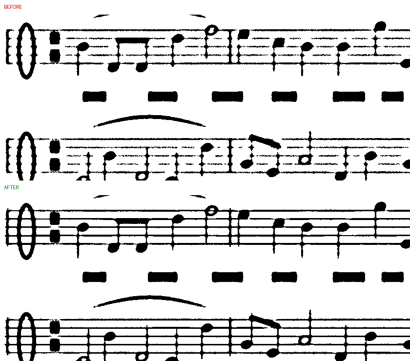

# 4단계: 악보 흑백 품질

실제 악보 사진이 없어 정답이 있는 시험 악보로 맞췄다. 실기기 사진으로 다시 확인해야 한다.

## 시험 방법

- `test/util/score.ts`: A4 악보를 2배로 그려 줄인 페이지(오선 0.13 mm, 기둥 0.12 mm, 온·반음표, 빔, 덧줄, 이음줄, 가사). 휴대폰 촬영 흉내(원근, 초점 흐림, 조명 감소, 잡음, 뒷면 비침).
- 측정: 오선 길이 중 남은 비율, **끊김 없는 오선 비율**(한 칸보다 긴 틈이 없는 선), 기둥, 4분음표 머리 채움, 2분음표 구멍, 엉뚱한 잉크(100만 화소당), 굵기(인쇄 대비 잉크 면적).
- `test/score-quality.test.ts`: 8가지 조건, 기준을 넘지 못하면 실패. `SCORE_REPORT=1`로 수치, `SCAN_DEBUG=1`로 이미지.

## 문제

카메라에서 먼 쪽(페이지 아래)이나 흐린 사진에서 오선과 기둥이 **점선처럼 끊겼다**. 가는 선은 흐려지면 대비가 잡음 수준까지 떨어져 지역 문턱값(Sauvola)이 일부 화소만 잉크로 본다. 멀고 흐린 사진에서 끊김 없는 오선은 48%뿐이었다.

시도한 것:

| 방법 | 결과 |
|---|---|
| 문턱 전 잡음 줄이기(흐림) | 더 나빠짐 (선 대비까지 줄어듦) |
| 문턱 완화 (k 0.2 → 0.06) | 끊김은 줄지만 뒷면 비침이 잉크로, 획이 굵어짐 |
| 약한 잉크 이어 붙이기 | 획 가장자리까지 자라 굵기 +40% |
| 가는 선 대비(블랙햇)로 이어 붙이기 | 끊김 0, 하지만 굵기 2배, 2분음표가 메워짐 |
| **선 방향 평균 후 가는 선 찾기 (채택)** | 아래 |

## 채택한 방법 (`addFaintLines`, `pipeline.ts`)

1. 회색 이미지를 선 방향(가로, 세로 따로)으로 평균 → 잡음은 줄고 선은 그대로.
2. 위아래(또는 좌우)보다 어두운 곳 = 가는 선. 그중 가장 진한 곳의 80% 이내만 표시(굵어지지 않게).
3. 종이보다 실제로 어두운 화소만, 충분히 긴 선만.
4. **원래 문턱값이 이미 그 선의 25% 이상을 잉크로 봤을 때만** 살린다. 끊긴 진짜 선은 통과하고, 한 번도 잉크로 잡힌 적 없는 뒷면 비침 선은 걸러진다. 음표 머리 같은 두꺼운 잉크는 근거로 치지 않는다(뒷면 선이 음표 머리에 닿아 살아나는 것을 막음).

함께 고친 것:
- 페이지 가장자리 자국: 테두리 띠 안에만 있는 잉크(살짝 넓게 자른 탁자·종이 끝)를 지움.
- WASM 메모리가 커질 때 미리 잡아 둔 데이터 참조가 무효가 되는 버그(첫 페이지에서만 보정이 빠짐). 반사광 합성 코드의 같은 위험도 정리.

## 결과 (끊김 없는 오선 / 굵기 / 엉뚱한 잉크)

| 조건 | 이전 | 이후 |
|---|---|---|
| 밝은 곳 | 100% / 1.25 / 0 | 100% / 1.26 / 0 |
| 초점 흐림 | 84% / 1.31 / 0 | 100% / 1.32 / 0 |
| 멀리서 (페이지 7MP) | 92% / 1.30 / 0 | 100% / 1.31 / 0 |
| 멀리 + 흐림 + 어두움 | 48% / 1.23 / 0 | 100% / 1.32 / 6 |
| 뒷면 비침 | 100% / 1.26 / 0 | 100% / 1.28 / 74 |
| 흐린 복사본 | 96% / 1.08 / 0 | 100% / 1.10 / 0 |
| 흐린 복사본 + 멀리 | 60% / 1.05 / 0 | 100% / 1.10 / 0 |

흑백 마무리 시간: 12MP 사진의 A4 페이지(1756×2485)에서 약 80 ms → 약 260 ms (이 서버 기준).

## 참고

- 자동 모드는 악보를 회색조로 고른다. 회색조에서는 선이 끊기지 않지만 옅다. 인쇄용으로 또렷하게 하려면 흑백을 고른다.
- 이음줄처럼 휘어진 가는 선은 이 보정 대상이 아니다.
